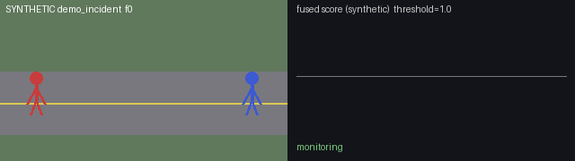
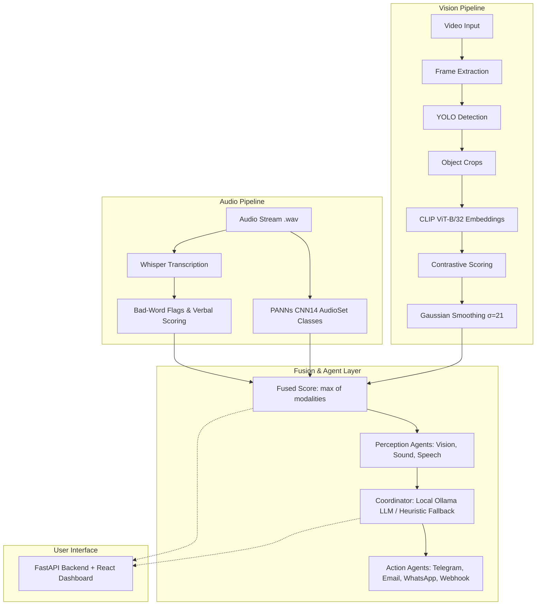

# Campus Safety Detection
Zero-shot video bullying and violence detection across video, audio, and speech with multi-agent alerting.

[](https://github.com/dhia-rek/campus-safety-detection/actions/workflows/ci.yml)



*Synthetic stick-figure demo showing UI playback and multi-agent alerting. Detection curves and scores shown are synthetic test fixtures, not live model outputs.*

## Overview

Traditional CCTV monitoring relies heavily on manual surveillance, which does not scale and introduces operator fatigue. This project implements a zero-shot multi-modal anomaly detection framework designed for school and university campus safety.

Instead of training supervised classifiers on violent campus samples, the system leverages natural language descriptions with vision-language models (OpenAI CLIP) and object detection (Ultralytics YOLO) to identify suspicious events. Visual detections are fused with audio classification (PANNs) and speech recognition (OpenAI Whisper) to reliably detect physical confrontations, distress sounds, and verbal harassment. A multi-agent layer coordinates perception signals, queries a local LLM for context synthesis, and triggers real-time alerts.

## Architecture



## How Detection Works

Visual detection evaluates object crops against contrastive prompt sets:
1. **Prompt Matching**: Text embeddings are precomputed for normal prompts (`prompts/normal.txt`) and abnormal prompts (`prompts/abnormal.txt`) using CLIP ViT-B/32 (via `open_clip` with OpenAI pretrained weights, `ViT-B-32-quickgelu`).
2. **Crop Scoring**: For each detected object crop embedding, the score is calculated as:
   $$\text{score} = \max(\text{sim}_{\text{abnormal}}) - \max(\text{sim}_{\text{normal}})$$
3. **Frame Aggregation**: The frame-level visual anomaly score takes the maximum score among all object crops detected within that frame.
4. **Temporal Smoothing**: A 1D Gaussian filter ($\sigma = 21$ frames) smooths the raw per-frame visual curve across the timeline.

## How Fusion Works

Multi-modal signals are synchronized at the frame level:
- **Audio & Verbal**: Sound event probabilities from PANNs and bad-word hit counts from Whisper are z-score normalized ($z = (x - \mu) / \sigma$) against their clip-level statistics.
- **Visual**: By default, the visual signal is preserved as raw contrastive scores (`visual_z`) to maintain global comparability across distinct clips. Setting `VISUAL_ZSCORE=1` normalizes visual scores locally per clip.
- **Fusion Calculation**: The fused score per frame is computed as:
  $$\text{fused\_score} = \max(\text{visual\_z}, \text{audio\_z}, \text{verbal\_z})$$
- **Caveat**: By default, `visual_z` represents raw contrastive differences rather than a true statistical z-score, yet it shares the same alert threshold comparison as the normalized audio and verbal streams.

## Quick Start

### 1. Demo Mode (No ML models or GPU required)

Run the lightweight dashboard API with synthetic test fixtures:

```bash
# Install core dependencies
uv sync

# Run the backend in demo mode
DEMO_MODE=1 uv run uvicorn src.dashboard.api:app --port 8000
```

Verify endpoints with `curl`:
```bash
# List available demo scenes
curl http://localhost:8000/api/scenes

# Trigger demo coordinator decision
curl http://localhost:8000/api/decision/demo_incident

# Send a manual test alert
curl -X POST http://localhost:8000/api/alert \
  -H "Content-Type: application/json" \
  -d '{"scene": "demo_incident", "frame": 50, "score": 1.75, "modality": "AUDIO"}'
```

To run the React front-end (optional):
```bash
cd web
npm install
npm run dev
```

### 2. Full ML Pipeline

To execute object detection, feature extraction, and multi-modal scoring:

```bash
# Install ML optional dependencies (includes PyTorch, open-clip, ultralytics, Whisper, PANNs)
uv sync --extra ml

# Run single-scene quick pipeline or full dataset processing
bash scripts/run_pipeline.sh quick
```
*Note: A dataset containing video clips and corresponding `.wav` audio files is required.*

## Configuration

Set configuration parameters via environment variables or a `.env` file (see `.env.example`):

| Variable | Default | Description |
|---|---|---|
| `DEMO_MODE` | `0` | Set to `1` to serve synthetic fixtures from `demo_data/` and mock alerts |
| `TELEGRAM_TOKEN` | *None* | Bot token for Telegram incident notifications |
| `WHISPER_MODEL` | `base` | Model size for speech transcription (`tiny`, `base`, `small`, `medium`, `large`) |
| `WHISPER_LANG` | *auto* | Target speech language code (e.g., `en`, `fr`); blank auto-detects |
| `OLLAMA_HOST` | `http://localhost:11434` | Endpoint URL for the local Ollama LLM service |
| `OLLAMA_MODEL` | `llama3.1:8b` | Model used by coordinator agent for incident analysis |
| `INCIDENT_WEBHOOK_URL`| *None* | Webhook URL (e.g. n8n or Make) for high-severity notifications |
| `ESCALATE_SEVERITIES` | `high` | Incident severities that trigger webhook escalation |
| `EMAIL_TO` | *None* | Destination address for email notifications |
| `SMTP_USER` | *None* | SMTP authentication user / email address |
| `SMTP_PASS` | *None* | SMTP authentication password / app password |
| `EMAIL_SEVERITIES` | `low,medium,high` | Comma-separated severities that trigger email alerts |
| `WHATSAPP_PHONE` | *None* | Target phone number for CallMeBot WhatsApp delivery |
| `CALLMEBOT_APIKEY` | *None* | API key for CallMeBot WhatsApp service |
| `WHATSAPP_SEVERITIES` | `low,medium,high` | Severities that trigger WhatsApp notifications |
| `VISUAL_ZSCORE` | `0` | Set to `1` to z-score visual curves per clip instead of raw values |
| `ECE_DATASET_ROOT` | *None* | Base directory path for campus video clips |
| `PROJECT_DATA_ROOT` | `runtime_data` | Root directory for intermediate features and pipeline scores |

## Results & Limitations

- **No benchmark claims**: The repository does not ship fixed quantitative performance figures or benchmark scores. Initial tests were conducted on private campus recordings and ShanghaiTech-style layouts.
- **Zero-shot lookalike confusion**: Zero-shot CLIP representations frequently trigger on visually similar dynamics—such as friendly sports, play-fighting, rapid running, or crowded rush-hour movement.
- **False positives**: High false-positive rates are expected in real-world visual deployments; the coordinator LLM and audio/verbal modalities exist specifically to filter visual noise.
- **Environmental factors**: Detection reliability degrades under challenging surveillance conditions, including low-light environments, extreme camera mounting angles, and heavy occlusions.

## Ethics & Privacy

Automated campus surveillance systems carry significant ethical responsibilities and legal obligations:
- **Human-in-the-Loop**: Outputs are strictly advisory triage cues. Decisions must never serve as the sole ground for disciplinary, legal, or administrative actions.
- **Data Minimisation & Local Compute**: The pipeline and the coordinator LLM (Ollama) run locally. The coordinator LLM receives only derived metadata (scores and transcribed words), never raw video frames.
- **Data Egress**: Telegram alerts push annotated frame captures over external networks to bot subscribers. Deployments must restrict subscription lists to authorized personnel.
- **Legal Compliance**: Implementations must comply with applicable data protection regulations (such as GDPR or FERPA), including video surveillance disclosure, retention policies, and subject consent where required.
- **Algorithmic Bias**: Text-image embeddings and audio models can carry demographic and behavioural biases. Systems must be audited for disparity in detection rates across groups.

## Licenses

- **Codebase**: MIT License.
- **Ultralytics YOLOv8**: AGPL-3.0 (weights are not bundled and must be obtained subject to Ultralytics licensing terms).
- **OpenAI CLIP**: Model weights licensed under MIT via `open_clip`.
- **OpenAI Whisper & PANNs**: MIT License.
- **Sample media**: `demo_data/` and `assets/demo.gif` are synthetic drawings generated by `scripts/make_demo_data.py`.
- **Footage**: No campus surveillance footage or private datasets are bundled with this repository.

## Deployment

A synthetic demo container can be deployed directly to Hugging Face Spaces. Refer to [`DEPLOY.md`](DEPLOY.md) for Docker configuration and space setup instructions.

## Project structure

```text
src/
  paths.py                    Dataset/runtime paths, overridable via environment variables
  agents/
    base.py                   Observation/Decision dataclasses and the Agent base classes
    registry.py               Plugin registry: auto-discovers agents in plugins/
    runtime.py                Runs one frame through perception, coordinator and actions
    context.py                Loads scene scores into the shared context; finds the peak frame
    coordinator.py            CLI demo that runs the full agent pipeline on one scene
    plugins/
      vision.py, sound.py, speech.py   Perception agents (one per modality)
      coordinator_llm.py      Coordinator: local LLM (Ollama) with a heuristic fallback
      action_telegram.py      Action: Telegram photo alert
      action_email.py         Action: HTML e-mail with inline frame and clip
      action_whatsapp.py      Action: WhatsApp message via CallMeBot
      action_webhook.py       Action: generic webhook POST
  alerts/
    notifier.py               Telegram sender (real or mock in demo mode)
    telegram_listener.py      Bot long-poll loop managing subscribers
  dashboard/api.py            FastAPI backend for the web UI
  pipeline/                   Offline ML pipeline, one module per step
    extract_frames.py, detect.py, crop.py, clip_model.py, embed.py, text_features.py,
    score.py, audio_score.py, transcribe.py, fuse.py, evaluate.py, visualize.py, ingest_clip.py
scripts/                      Batch runners, demo-data generator, ingestion helpers
prompts/                      Prompt lists (normal, abnormal, bad words, audio classes)
demo_data/                    Synthetic scenes and score CSVs for demo mode
web/                          React (Vite) dashboard
tests/                        pytest suite
deploy/, automation/          Hugging Face Space card, n8n example
```

## Tech Stack

- **Backend & Agents**: Python 3.10+, FastAPI, Pydantic, Uvicorn, Requests
- **Machine Learning**: PyTorch, open-clip-torch, Ultralytics YOLOv8, OpenAI Whisper, PANNs-inference, Scipy, NumPy, Pandas
- **Frontend**: React, Vite, Lucide Icons
- **Local Reasoning**: Ollama (Llama 3.1 8B)

## Development

```bash
uv sync                  # core + dev dependencies (add --extra ml for the full pipeline)
uv run pytest -q         # tests
uv run ruff check .      # lint, including Google-style docstring rules
uv run mypy              # type check (basic mode)
uv run interrogate       # docstring coverage, fails under 90%
cd web && npm install && npm run build   # frontend
```

CI runs lint, type check, docstring coverage and tests on every pull request.
